# CONCEPTS OF DATA STRUCTURES AND ALGORITHMS

Each topic below has a title, an implementation tag, the explanation, and a code card image (in `code-cards/`). The code in every card is copied from the project's source files; only the numbered comments were added.

---

## DATA STRUCTURES

*The project builds its own **Queue** from a **Singly Linked List** in **OrderNode.java** and **OrderQueue.java**, and uses Java's built-in **ArrayList** (a dynamic array) in **OrderManager.java**.*

---

### Singly Linked List *(OrderNode)*
**[Complete Data Structure Implementation]**

The **OrderNode** class is the building block of the project's linked list. Each node holds two things: **data**, the **Order** it stores, and **next**, a reference to the node that comes after it. When a node is created, its next reference is set to **null**, meaning it does not point to any other node yet. By linking nodes through their next references, the program forms a chain of orders where each node only knows about the one after it. This is called a **singly linked list**.

Unlike an array, a linked list does not need one continuous block of memory and never has to be resized. A new node can be attached at the end just by changing one reference, which is why adding an order takes **O(1)** time. The trade-off is that there is no direct access by index: to reach the fifth order, the program has to start at the first node and follow four next references. The **OrderQueue** class uses this chain to store every pending order.

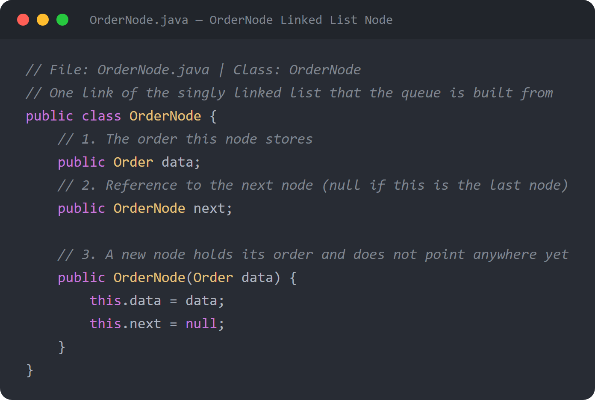

---

### Queue — FIFO Structure *(OrderQueue)*
**[Complete Data Structure Implementation]**

The **OrderQueue** class is a **First-In, First-Out (FIFO)** queue built from scratch on top of the linked list. It keeps two pointers: **front**, which points to the oldest order (the next one to be served), and **rear**, which points to the newest order (the last one placed). It also keeps a **size** counter of how many orders are waiting. When a queue is created, front and rear are both **null** and size is **0**, which represents an empty queue.

Keeping a pointer to **both ends** is what makes the queue fast. New orders are always added at the rear and orders are always served from the front, so neither operation ever has to walk through the list. This matches how a real canteen line works: the first student to order is the first one served, which keeps the service **fair**.

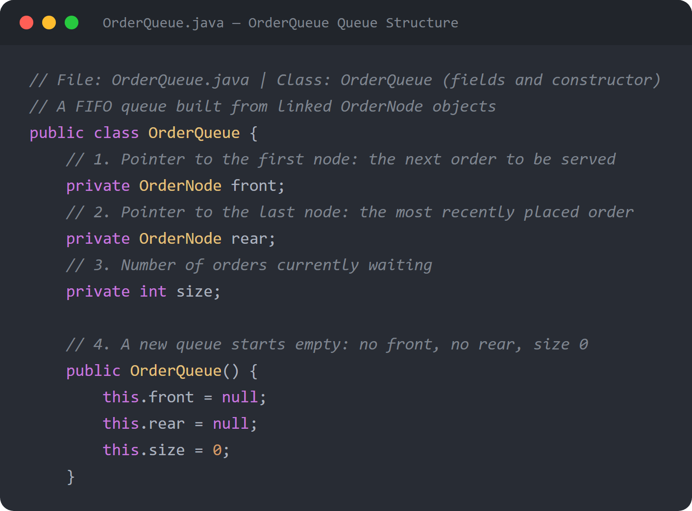

---

### Queue Insertion *(enqueue)*
**[Complete Algorithm Implementation]**

The **enqueue** method adds a new order to the **rear** of the queue. It first wraps the order inside a new **OrderNode**. If the queue is empty (**rear == null**), the new node becomes both the front and the rear, because it is the only order in line. Otherwise, the current rear node's **next** reference is set to the new node, linking it to the end of the chain, and **rear** is moved to the new node. Finally, **size** is increased by one.

Because the method only changes a few references and never loops through the list, it runs in **O(1)** time no matter how many orders are waiting. The program calls enqueue from **placeOrder()** in OrderManager.java (Feature 1: Place Order). placeOrder first finds the chosen menu item, rejects invalid input, computes **total = price × quantity**, and creates the order with the next sequential ID (starting at **1001**) and status **PENDING** before enqueuing it.

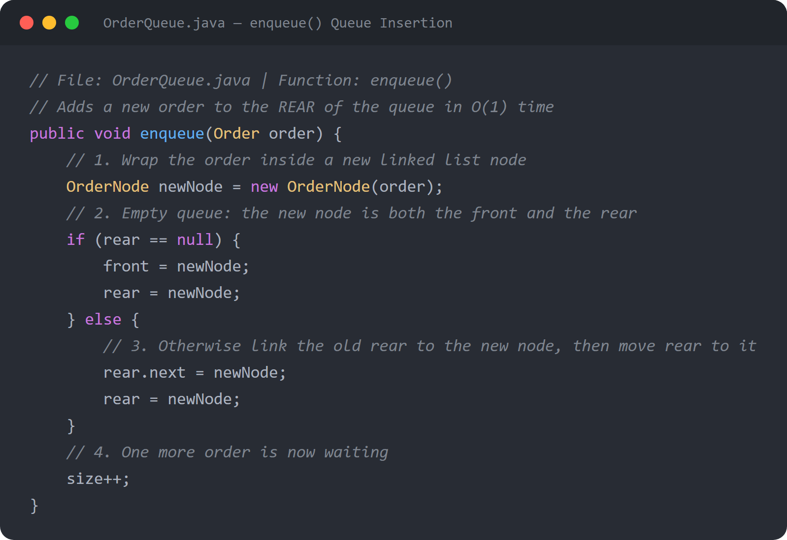

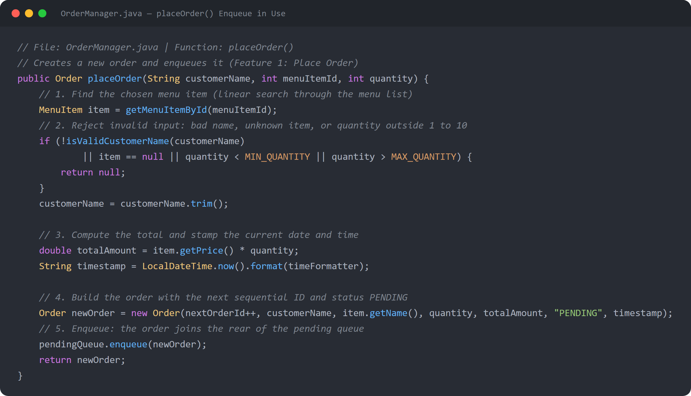

---

### Queue Removal *(dequeue)*
**[Complete Algorithm Implementation]**

The **dequeue** method removes and returns the order at the **front** of the queue. If the queue is empty it returns **null**, so the program never tries to serve an order that does not exist. Otherwise, it saves the front node's order, then moves **front** to the next node. The old front node is no longer referenced by anything, so Java's garbage collector frees it. If moving front makes it **null**, the queue just became empty, so **rear** is also set to null. Without this step, rear would still point to a node that is no longer in the queue. Finally, **size** is decreased by one.

Like enqueue, dequeue only updates references and runs in **O(1)** time. The program calls it from **serveNextOrder()** (Feature 2: Serve Next Order), which takes the order that has waited the longest, changes its status to **SERVED**, and adds it to the end of the **servedOrders** ArrayList. Before serving, the program shows the next order using **peek** and asks the user to confirm, so an order is only removed when the user answers **Y**.

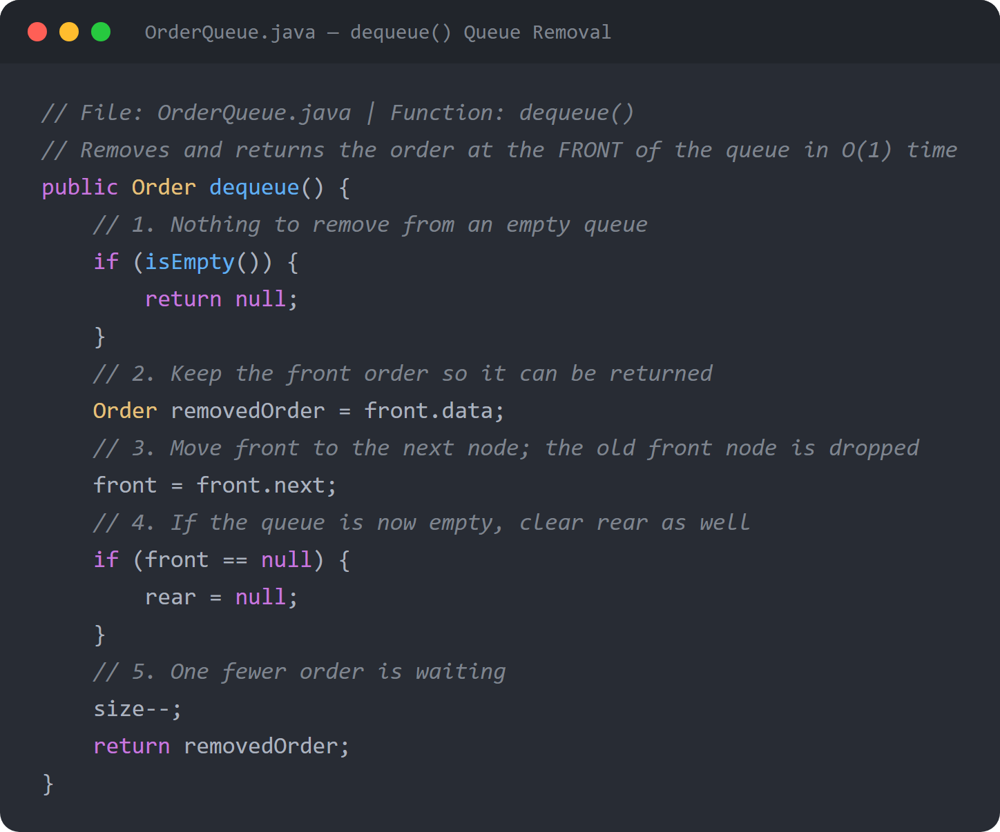

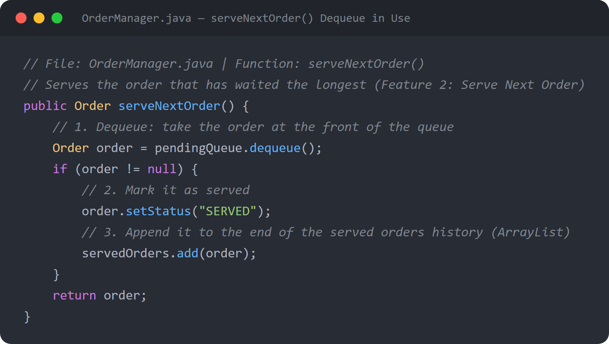

---

### Queue Helper Operations *(peek, isEmpty, getSize)*
**[Complete Algorithm Implementation]**

The **peek** method returns the order at the front of the queue **without removing it**, or **null** if the queue is empty. The program uses it through **peekNextOrder()** to show the user which order is next before asking whether to serve it. The **isEmpty** method checks whether **front == null**; a queue with no front node has no orders. Both **dequeue** and **peek** call isEmpty first so they never read from an empty queue. The **getSize** method returns the **size** counter that enqueue and dequeue keep up to date.

All three helpers run in **O(1)** time because each one reads a single field. Note that **getSize()** is available but is not called anywhere in the current program. The header and receipt count the pending orders with **getPendingOrders().size()**, which first walks the whole list.

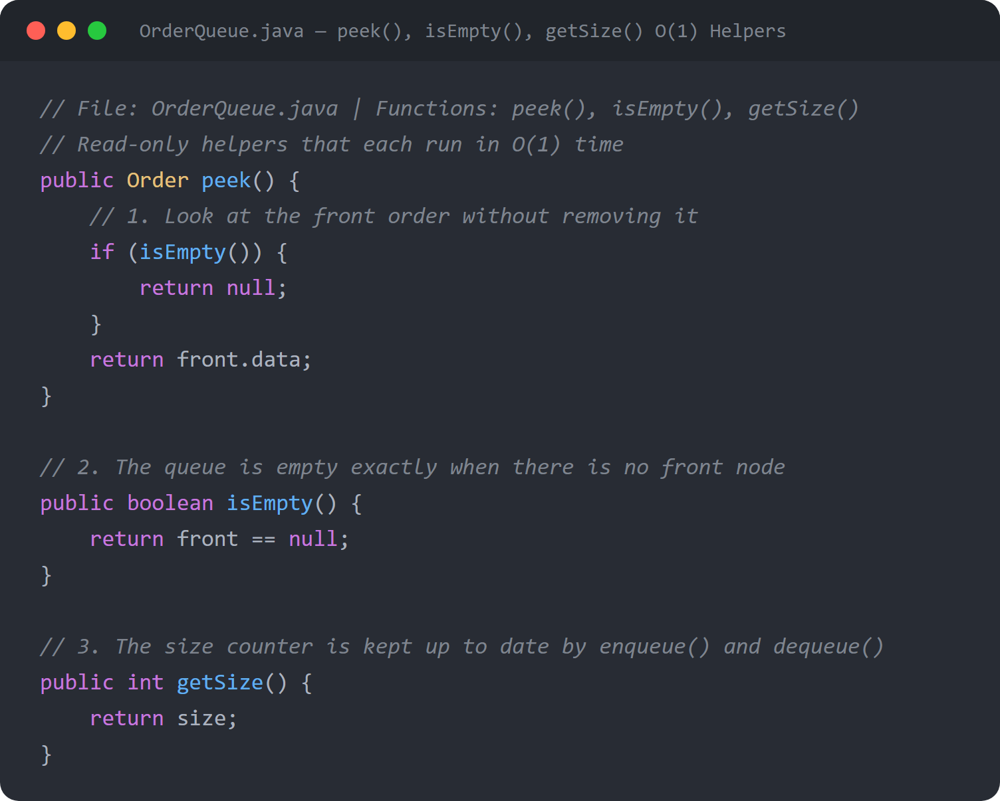

---

### Linked List Traversal *(getAllOrders)*
**[Complete Algorithm Implementation]**

The **getAllOrders** method visits every node in the queue from **front to rear** and copies each order into a new list. It starts a **current** pointer at the front node, adds that node's order to the list, then moves current to **current.next**. The loop repeats until current becomes **null**, which means the end of the chain has been reached. The result is every pending order in exact **FIFO** order.

The traversal **does not change the queue**: no order is removed and front and rear stay the same. It visits each of the n nodes once, so it runs in **O(n)** time and uses **O(n)** extra memory for the new list. The program uses it in two places: **getPendingOrders()**, which shows the pending orders table (Feature 4) and counts the orders in the header, and **linearSearchOrder()**, which searches the pending orders by ID.

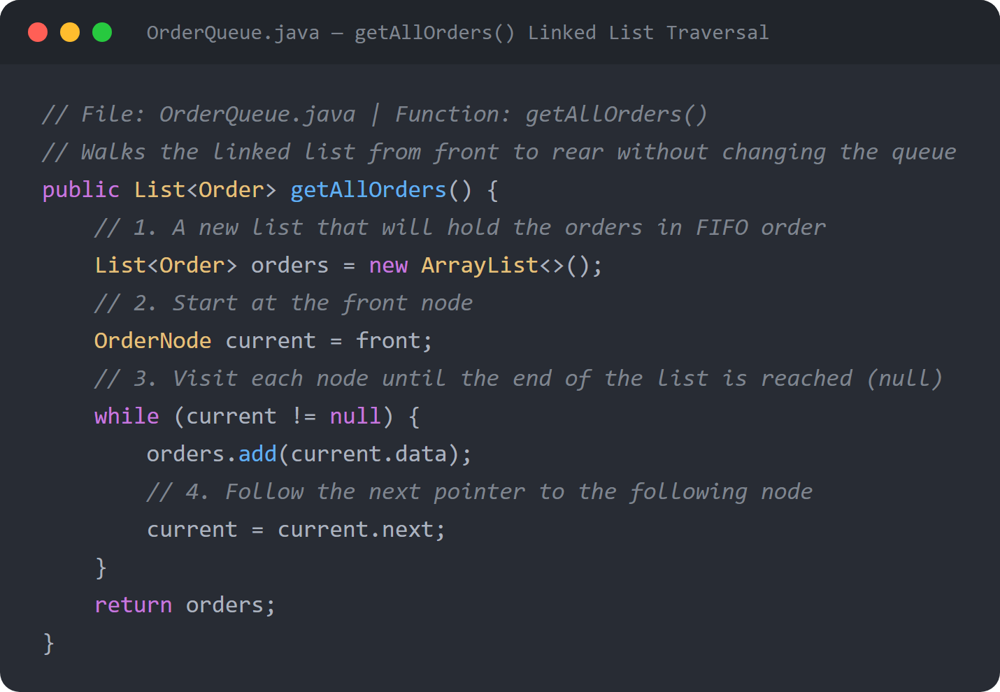

---

### Dynamic Array *(ArrayList — menu and servedOrders)*
**[Built-in Java Data Structure]**

The program uses Java's **ArrayList** for two lists in **OrderManager**: **menu**, which holds the 7 canteen items, and **servedOrders**, which keeps the history of every order that has been served. An ArrayList is a **dynamic array**: it stores elements next to each other in memory, so any element can be read or replaced by its index with **get(i)** and **set(i, value)** in **O(1)** time. When it runs out of room, it automatically grows into a bigger array, so **add()** at the end takes **O(1)** time on average (amortized).

The **menu** list is filled once by **initializeMenu()** when the program starts. **servedOrders** grows by one each time **serveNextOrder()** serves an order. Fast index access is what makes ArrayList a good fit for **insertion sort**, which reads and shifts elements by position. The method **getServedOrders()** returns a **copy** of the history (**new ArrayList<>(servedOrders)**, O(n)), so other parts of the program can read the orders without changing the real list.

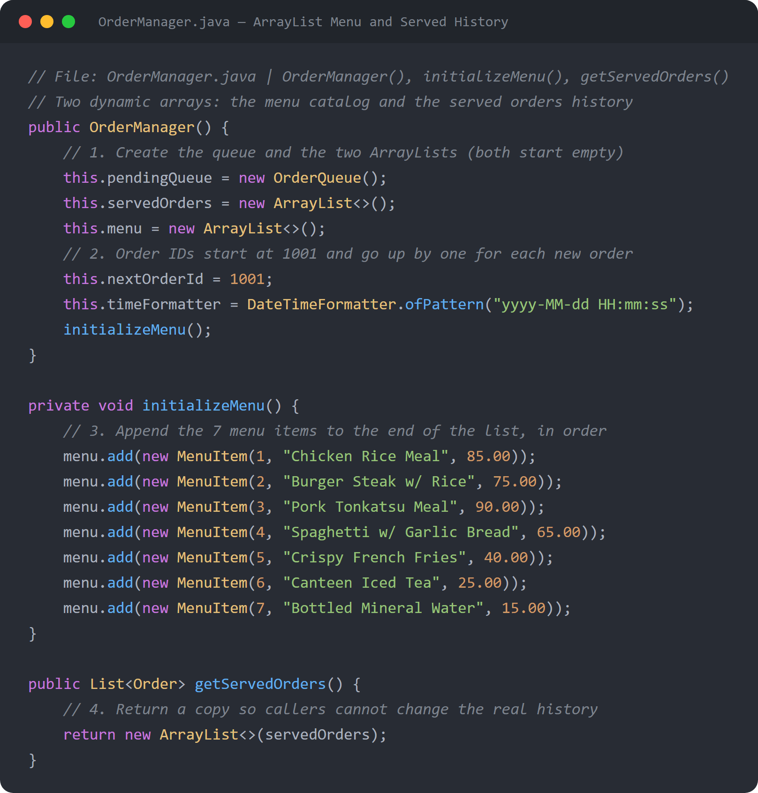

---

## SEARCHING ALGORITHMS

*The project implements **Linear Search** in **OrderManager.java**, in two places: searching orders by ID, and finding a menu item by its number.*

---

### Linear Search *(linearSearchOrder)*
**[Complete Algorithm Implementation]**

The **linearSearchOrder** method finds an order by its **Order ID** by checking the records **one by one**. It searches in two steps. First, it gets the pending orders in queue order using **getAllOrders()** and compares each order's ID with the target ID. If no pending order matches, it then goes through the **servedOrders** list the same way. As soon as an ID matches, the method returns that order right away without checking the rest. If both lists are checked and nothing matches, it returns **null**, and the program shows **"Order not found"**. Because it checks both lists, the search finds an order whether it is still **PENDING** or already **SERVED**.

In the **best case**, the target is the first pending order, so only **one comparison** is made. However, **getAllOrders()** first walks the whole queue to build the pending list, so the method always takes at least **O(p)** time, where p is the number of pending orders. In the **worst case**, the order is the last served order or does not exist, so every record is checked: **O(n)** time, where n is the total number of pending and served orders. Linear search is used here because the pending orders are stored in a **linked list**, which has no index access, so a faster method like binary search cannot jump to the middle of it. When the order is found, the program also shows how long the search took, measured with **System.nanoTime()** in microseconds (µs).

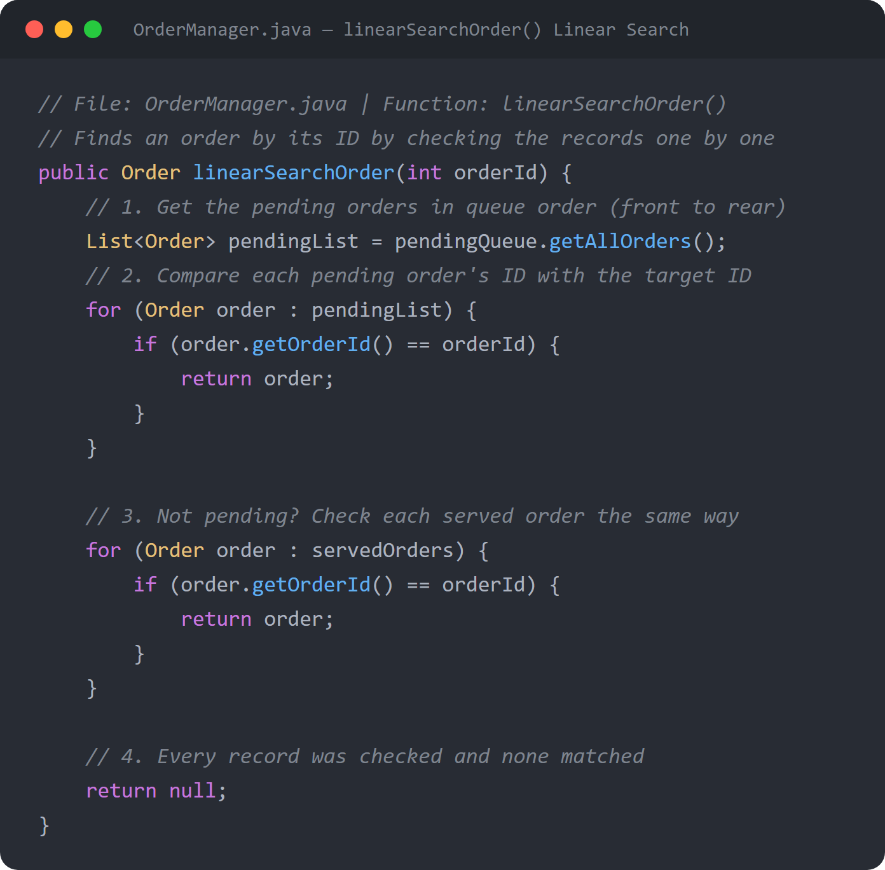

---

### Linear Search *(getMenuItemById)*
**[Complete Algorithm Implementation]**

The **getMenuItemById** method finds the menu item the customer picked. It goes through the **menu** ArrayList from the first item to the last and compares each item's ID with the number the user entered. It returns the first item whose ID matches. If no item matches, it returns **null**, and **placeOrder()** then rejects the order.

This search runs in **O(n)** time in the worst case, where n is the number of menu items. Since the menu has only **7** items, it always finishes after at most 7 comparisons. It is called at the start of **placeOrder()** to look up the item's **name** and **price**, which are needed to build the order and compute its total.

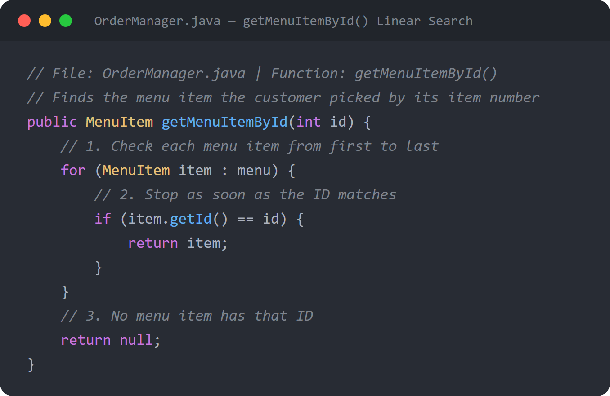

---

## SORTING ALGORITHMS

*The project implements **Insertion Sort** in **OrderManager.java** to rank the completed orders by their total amount.*

---

### Insertion Sort *(getServedOrdersSortedByAmount)*
**[Complete Algorithm Implementation]**

The **getServedOrdersSortedByAmount** method sorts the served orders by **total amount** using insertion sort. It first makes a **copy** of the servedOrders list, so the real history keeps the order in which the orders were served. It then treats the first element as an already sorted part and goes through the rest from **index 1**. For each position i, it takes that order as the **key** and compares it with the orders before it (index j, moving left). In **descending** mode, every order with a **smaller** amount than the key is shifted one place to the right. When the loop stops, the key is placed into the gap at **j + 1**. After each pass, the sorted part grows by one, until the whole list is sorted from **highest to lowest** amount. If **descending** is false, the same steps shift **larger** amounts instead, which sorts from lowest to highest. The program always calls it with **true** (Feature 5).

In the **worst** and **average** cases, insertion sort runs in **O(n²)** time, because each key may be compared with every order before it. In the **best case**, when the list is already sorted, each key needs only one comparison and the sort runs in **O(n)** time. It sorts the copy **in place**, so the only extra memory is the copy itself (**O(n)**). Insertion sort is also **stable**: it only shifts orders whose amount is strictly smaller (or larger), so orders with the same total keep the order in which they were served. It is a good fit for this program because the number of served orders in one session is small, and it works well on lists that are already nearly sorted.

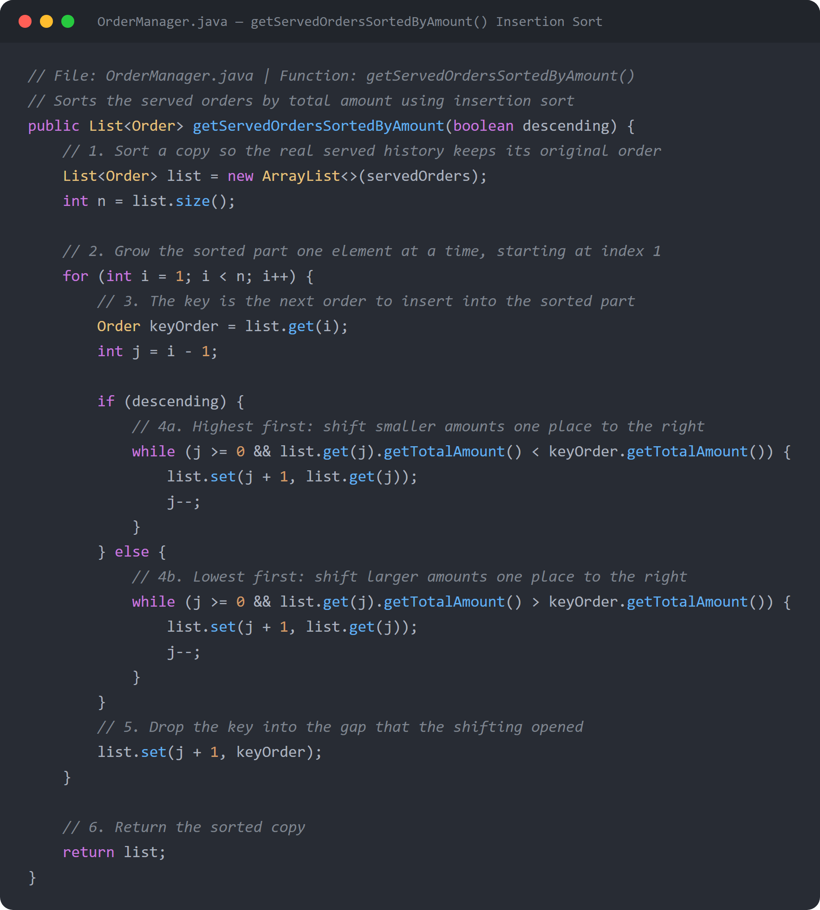

---

## ALGORITHM ANALYSIS

*The project measures the actual running time of its search and sort in **Main.java**.*

---

### Measuring Running Time *(System.nanoTime)*
**[Supporting Concept]**

Besides the Big-O analysis above, the program measures how long its algorithms **actually take** while it runs. Right before calling the algorithm, it reads the clock with **System.nanoTime()**; right after, it reads the clock again. The difference is the running time in **nanoseconds**, which the program divides by **1000.0** to show it in **microseconds (µs)**. This is done for **insertion sort** in **handleViewCompletedOrdersSorted()** (Option 5) and for **linear search** in **handleSearchOrder()** (Option 3, where the time is shown when the order is found).

Only the algorithm call is placed between the two clock readings, so printing the table is not counted in the time. For the sort, the program also shows the number of records, so the user can see how the time grows as more orders are served. The measured time changes slightly on every run, because it depends on the computer and on what else it is doing at that moment. It shows the actual speed on this machine, while Big-O describes how the time grows as the input gets larger.

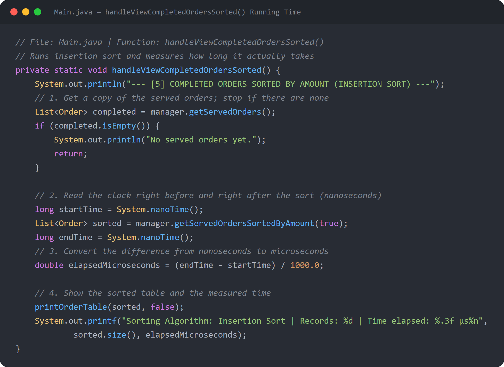

---

## SUMMARY OF TIME COMPLEXITY

| Operation | Method (file) | Data structure | Best | Worst |
|---|---|---|---|---|
| Add order to queue | `enqueue()` (OrderQueue.java) | Linked list queue | O(1) | O(1) |
| Serve next order | `dequeue()` (OrderQueue.java) | Linked list queue | O(1) | O(1) |
| Look at next order | `peek()` (OrderQueue.java) | Linked list queue | O(1) | O(1) |
| Check if queue is empty | `isEmpty()` (OrderQueue.java) | Linked list queue | O(1) | O(1) |
| Number of pending orders | `getSize()` (OrderQueue.java) | Linked list queue | O(1) | O(1) |
| List all pending orders | `getAllOrders()` (OrderQueue.java) | Linked list traversal | O(n) | O(n) |
| Add to served history | `servedOrders.add()` (OrderManager.java) | ArrayList | O(1) amortized | O(n) when it grows |
| Copy served history | `getServedOrders()` (OrderManager.java) | ArrayList | O(n) | O(n) |
| Search order by ID | `linearSearchOrder()` (OrderManager.java) | Queue + ArrayList | O(p), p = pending orders | O(n) |
| Find menu item | `getMenuItemById()` (OrderManager.java) | ArrayList | O(1) | O(n), n = 7 |
| Sort served orders by amount | `getServedOrdersSortedByAmount()` (OrderManager.java) | ArrayList | O(n) | O(n²) |
