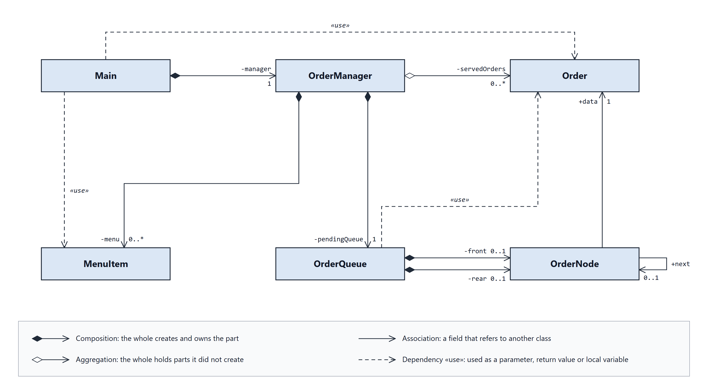
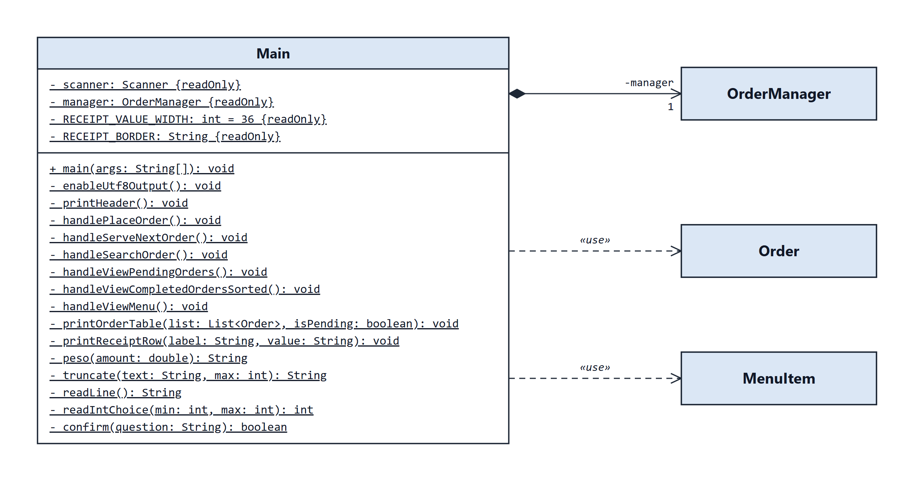
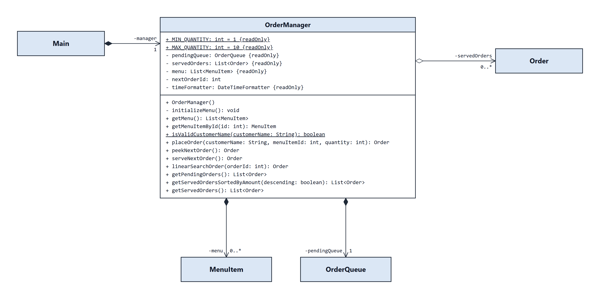
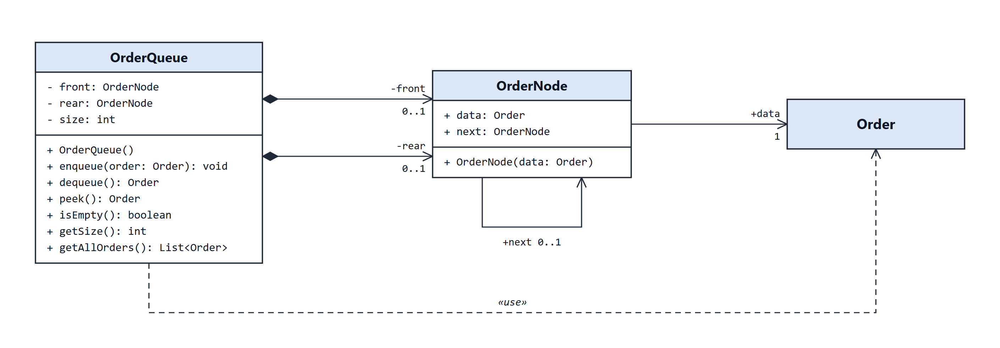
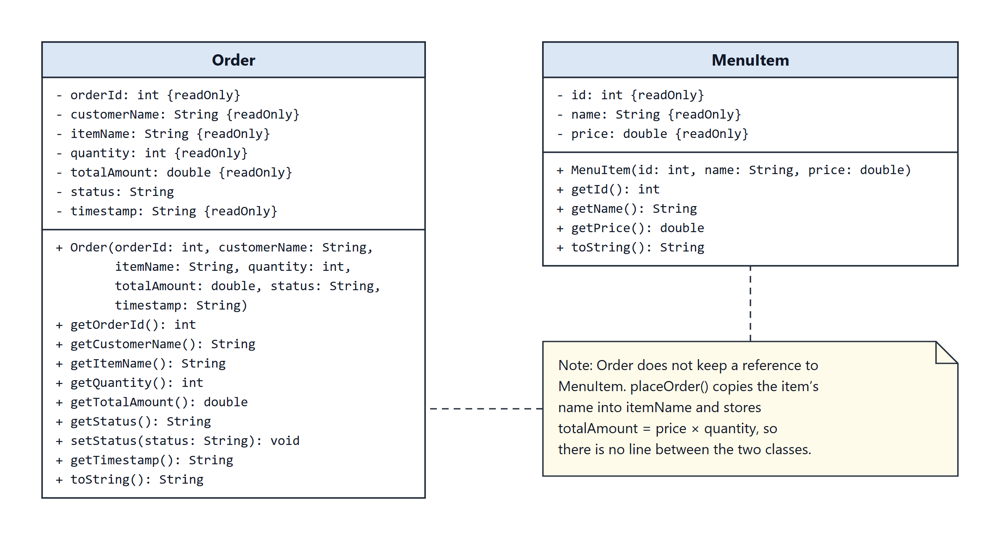

# UML CLASS DIAGRAM

The class diagram of the Canteen Order Queue Management System is split into five figures. **Figure 1** shows all six classes and how they connect. **Figures 2 to 5** zoom in on each part of the system and show every field and method. Each class is shown in full in exactly one figure. Classes drawn as a plain name box are shown in full in another figure.

**How to read the figures**
- `+` means public and `-` means private.
- An **underlined** member is **static**: it belongs to the class itself, not to an object.
- `{readOnly}` marks a **final** field: its value cannot change after it is set.
- Each field is written as `name: Type`, and each method as `name(parameter: Type): ReturnType`.
- The numbers at the end of a line show how many objects are involved: `1` means exactly one, `0..1` means zero or one, and `0..*` means any number.

---

## Figure 1. Class Overview

*Figure 1. The six classes of the system and the relationships between them.*

The system has **six classes**, and each one has a single job. **Main** is the console user interface: it shows the menu, reads the user's input, and prints the results. **OrderManager** holds the business logic and runs the core algorithms. **OrderQueue** and **OrderNode** together form the custom **FIFO queue** of pending orders, built as a linked list. **Order** and **MenuItem** are the data classes that store the information about an order and a menu item.

The lines show how the classes are connected:
- **Main → OrderManager (composition, 1):** Main creates the one OrderManager the program uses, and keeps it for as long as the program runs.
- **OrderManager → OrderQueue (composition, 1)** and **OrderManager → MenuItem (composition, 0..\*):** OrderManager creates and owns the pending queue and all of the menu items.
- **OrderManager → Order (aggregation, 0..\*):** the **servedOrders** list holds orders that came out of the queue after being served. Aggregation is used because the list did not create these orders; they were handed over from the queue.
- **OrderQueue → OrderNode (composition, front and rear, 0..1 each):** the queue creates a node for every order it receives. Both pointers are empty (0) when the queue has no orders.
- **OrderNode → Order (association, 1)** and **OrderNode → OrderNode (association, next, 0..1):** each node holds one order and points to the next node. The last node points to nothing.
- **Dashed «use» lines:** Main and OrderQueue use Order (and Main uses MenuItem) only as parameters, return values, or local variables, not as stored fields.

There is **no inheritance** in the system: no class extends or implements another.

---

## Figure 2. Main — User Interface

*Figure 2. The Main class and the classes it works with.*

**Main** runs the console program. Every member is **static** (underlined), because the program never creates a Main object; it runs directly from the **main()** method. Main has four fields:
- **scanner** reads what the user types.
- **manager** is the single OrderManager that every option goes through (composition, 1).
- **RECEIPT_VALUE_WIDTH** (36) and **RECEIPT_BORDER** set the width of the receipt boxes the program prints.

The methods fall into four groups:
- **main()** shows the menu in a loop until the user exits. Before the loop, **enableUtf8Output()** switches the console to UTF-8, so the peso sign (₱) displays correctly.
- The **handle methods** run one menu option each: **handlePlaceOrder()** (1), **handleServeNextOrder()** (2), **handleSearchOrder()** (3), **handleViewPendingOrders()** (4), **handleViewCompletedOrdersSorted()** (5), and **handleViewMenu()** (6). Option 7 (Exit) is handled inside main().
- The **display helpers** format the output: **printHeader()**, **printOrderTable()**, **printReceiptRow()**, **peso()**, and **truncate()**.
- The **input helpers** validate what the user types: **readLine()** reads one line, **readIntChoice()** only accepts a whole number within a given range, and **confirm()** only accepts Y or N.

Main depends on **Order** and **MenuItem** (dashed «use» lines) because it reads their getters to print receipts, tables, and the menu. It never stores them in its own fields.

---

## Figure 3. OrderManager — Business Logic

*Figure 3. The OrderManager class, which connects the user interface to the data structures.*

**OrderManager** is the controller of the system: Main asks it to do the work, and it uses the data structures to do it. Its fields:
- **MIN_QUANTITY** (1) and **MAX_QUANTITY** (10) are static constants for the allowed quantity.
- **pendingQueue** is the FIFO queue of orders that are waiting.
- **servedOrders** is an ArrayList that keeps the history of served orders.
- **menu** is an ArrayList of the 7 canteen items.
- **nextOrderId** gives each new order the next ID, starting at **1001**.
- **timeFormatter** formats each order's timestamp.

When it is created, the constructor builds the queue and both lists, then fills the menu through **initializeMenu()**.

Each method supports one feature:
- **placeOrder()** checks the input, computes the total, creates the order, and **enqueues** it. It uses **getMenuItemById()** (linear search) to find the item, and **isValidCustomerName()** (static) to make sure the name contains a letter.
- **peekNextOrder()** shows the next order to serve, and **serveNextOrder()** **dequeues** it, marks it as SERVED, and adds it to servedOrders.
- **linearSearchOrder()** finds an order by its ID.
- **getPendingOrders()** lists the queue in FIFO order.
- **getServedOrdersSortedByAmount()** sorts the served orders with **insertion sort**.
- **getMenu()** and **getServedOrders()** give Main the data it needs to display. getServedOrders() returns a copy.

---

## Figure 4. OrderQueue and OrderNode — The Custom Queue

*Figure 4. The FIFO queue, built from linked OrderNode objects.*

**OrderQueue** is the project's own **First-In, First-Out** queue. It does not use Java's built-in queue. It keeps three private fields:
- **front** points to the oldest order, which is the next one to be served.
- **rear** points to the newest order.
- **size** counts the orders that are waiting.

Its methods:
- **enqueue()** adds an order at the rear and **dequeue()** removes the order at the front. Both run in **O(1)** time.
- **peek()** looks at the front order without removing it.
- **isEmpty()** checks whether the queue has no orders.
- **getSize()** returns the count.
- **getAllOrders()** walks the whole queue from front to rear and returns the orders as a list.

**OrderNode** is one link in the chain. It has two public fields: **data**, the order it holds (1), and **next**, the following node (0..1). The **self-association** on OrderNode shows that nodes point to other nodes, which is what makes it a **linked list**. The queue **creates** a new node every time an order is enqueued, which is why front and rear are drawn as **composition**. The queue depends on **Order** (dashed «use» line) because its methods take and return Order objects.

---

## Figure 5. Order and MenuItem — Data Classes

*Figure 5. The two data classes that store the information about orders and menu items.*

**Order** stores one customer's order. Its fields:
- **orderId**, **customerName**, **itemName**, **quantity**, **totalAmount**, and **timestamp** are **final** (`{readOnly}`), so they never change after the order is created.
- **status** is the only field that can change. It starts as **PENDING** and becomes **SERVED** through **setStatus()** when the order is served.

All fields are private and can only be read through the **getters**. This is **encapsulation**, and it protects the order's data from accidental changes. **toString()** returns a one-line summary of the order.

**MenuItem** stores one item on the canteen menu: its number (**id**), **name**, and **price**. All three are final and are read through getters, and toString() formats the item for the menu list.

The note explains why there is **no line between Order and MenuItem**: an order does not keep a reference to the menu item. When an order is placed, **placeOrder()** copies the item's name into **itemName** and saves **totalAmount = price × quantity**. Because the order keeps its own copy of the item name and the total, it never needs the MenuItem again after it is created.
